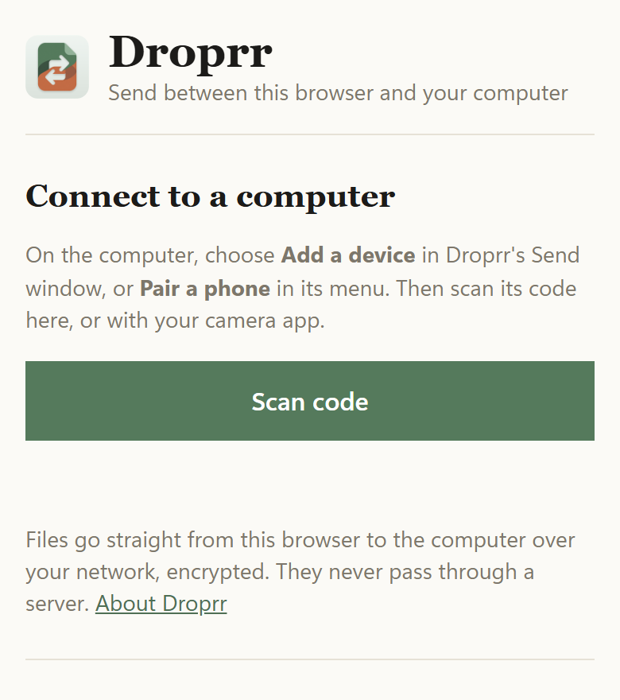
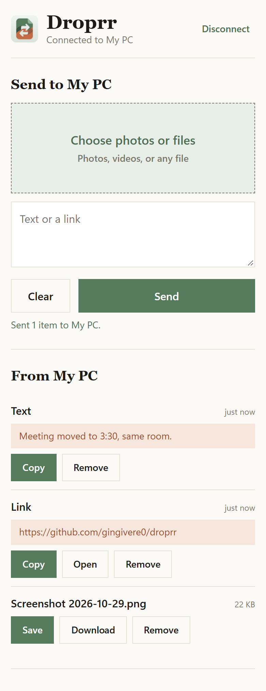

# Droprr

Droprr pushes files, photos, text, and links to a specific device of your own: a Windows PC, a Mac, or an iPhone. It works at home and away: on the same Wi-Fi, devices find each other and talk directly, and anywhere else they reach each other over your private [Tailscale](https://tailscale.com) network. You pick the device and send.

https://github.com/user-attachments/assets/ffdede5f-c8e2-46f5-a341-a4838f963e42

## Install

Download everything from the [latest release](https://github.com/gingivere0/droprr/releases/latest). Every platform uses the same version number.

| Platform | What to get | First run |
| --- | --- | --- |
| **Windows 10 or 11** | `DroprrSetup-<version>.exe` | It isn't code-signed yet, so SmartScreen says "Windows protected your PC". Choose **More info**, then **Run anyway**. It installs just for you, with no administrator rights and no separate .NET install. |
| **Mac** (macOS 14 or later, Apple silicon or Intel) | `Droprr-<version>.dmg` | Open the disk image and drag Droprr to Applications. It's signed and notarized by Apple, so it opens like any other app. |
| **iPhone** | Nothing to install | The iPhone app is waiting for App Store approval. Until then, use the [Droprr website](https://gingivere0.github.io/droprr/) in Safari, as shown in [In a browser](#in-a-browser). You can also send from the share sheet with the optional [Shortcuts](#iphone-shortcuts-optional). |

Then, on the computer, choose **Add a device** (the plus after the device tiles in the Send window) and scan the code with your phone's camera.

## How it works

- **Wi-Fi first, then Tailscale.** On the same Wi-Fi or wired network, devices find each other with Bonjour and talk over HTTPS on port `53319`. Each device has its own certificate, and each pins the other's, so the connection is encrypted and can't be impersonated, with no Tailscale needed. Anywhere else, Droprr falls back to Tailscale, which encrypts the traffic itself; computers accept those plain connections only from Tailscale addresses (`100.64.0.0/10`, `fd7a:115c:a1e0::/48`) and from the device itself, and Droprr never sends anything unencrypted to an address outside Tailscale. The status says which path each send took.
- **One port.** Each computer listens on port `53318` by default (changeable in Settings).
- **A token per device.** Every request carries a secret token. Each computer has a main token, which goes in its pairing QR code. Pairing gives every device its own token, and removing a device in Settings revokes its token without affecting the others. A device never sends its own main token to anyone. Tokens are stored encrypted for your Windows account on Windows, and in the Keychain on the Mac and iPhone.
- **Phones collect.** An iPhone can't accept connections in the background, so anything sent to it waits on the sending computer for up to 7 days. The phone collects it when the app opens, or when you pull to refresh on Received.
- **An open protocol.** It's a small HTTP API, described in [docs/PROTOCOL.md](docs/PROTOCOL.md).

## Features

- **Send files, photos, text, and links** from each app's Send window, from Explorer's **Send to › Droprr** on Windows, from the share sheet (**Share › Droprr**) on the Mac and iPhone, or straight from the clipboard with **Send clipboard**.
- **Clear sending status.** "Sending…" shows the moment you send, with the path being tried (Wi-Fi or Tailscale), a progress bar for files, and **Cancel**. A device that can't be reached fails within seconds, and large files take as long as they need: a send only gives up if nothing moves for two minutes. Sending to an iPhone that just closed Droprr queues the items for it instead.
- **Received history.** Recent items appear in the Send window and the tray's **Recent** menu on Windows, in the menu bar panel on the Mac, and in the **Received** tab on the iPhone, so you can open them again. On Windows, each one also has buttons to copy it or show it in its folder. Files are saved to a `Droprr` folder in Downloads on computers, and to the app's Received folder (visible in the Files app) on the iPhone.
- **Phone inbox.** Items for an iPhone queue on the computer, with an "N waiting" badge on the iPhone's device tile that you can click to clear them.
- **Clipboard.** Received text and links are copied to the clipboard, and **Auto-copy received items to clipboard** copies files and images too. On Windows, these copies are kept out of clipboard history and cloud clipboard.
- **Looks.** Out of the box, every device uses **Light** mode, the **Atelier** style, and the **Sage** theme. You can change all three in Settings.
- **Styles.** Four window styles, the same on every device: **Material You** (tonal surfaces and big rounded shapes), **Clay** (soft, puffy 3D shapes), **Spatial** (dark frosted glass, always dark), and **Atelier** (ivory paper and serif titles, the default).
- **Color themes.** Six themes: Graphite & Lime, Sunset, Cherry, Rose Gold, Sage (the default), and Olive & Mustard. The app's icons (the tray or menu bar icon, title bars, and the iPhone home screen) follow the theme.
- **Light, Dark, or System.** Light by default. You can also pick Dark, or follow the system's appearance. Style, theme, and mode all apply instantly while Settings is open, and Cancel puts them back.
- **Pairing.** Pair an iPhone by scanning a computer's QR code. Pairing goes both ways: the phone saves the computer's address and a token, and the computer adds the phone to its devices. Computers pair with each other the same way when you add one by hand (see [Pairing](#pairing)).
- **Missing Token tiles.** A computer listed without a token says **Missing Token**. Clicking it opens Settings with that device's token field ready to type into.
- **Masked tokens.** Tokens show as dots in Settings until you choose to show them. On Windows, **Copy** copies this PC's token without showing it.
- **Wi-Fi pairing.** Devices on the same network show up under **Nearby on this network** in Settings. Choosing **Pair** shows the same six-digit code on both screens; accept on the other device only if its code matches, and only if you started the pairing. No token is shown or typed. The code is built so nobody in between can make two different codes match, and a device that's already paired can't be paired again (or taken over) without removing it first. Settings also shows the path each device last used, and the **Local network** switch turns all of this off.
- **Safer receiving.** Received files are marked as coming from another computer (Mark of the Web on Windows, quarantine on the Mac). On Windows, only common media, document, and text files open with a click, and anything else is shown in Explorer instead. Only `http` and `https` links ever open, and any other "link" is received as text.

## Setup

The [Install](#install) steps above are all most people need. This section covers Tailscale, the details of each app, and building from source.

For use away from home, install Tailscale on every device and sign in to the same tailnet. On one Wi-Fi network, Droprr works without it.

### Windows

**Install:** run `DroprrSetup-<version>.exe`. It installs Droprr just for you, in `%LOCALAPPDATA%\Programs\Droprr`, without administrator rights or a separate .NET install. It adds Droprr to the Start menu (so Windows Search finds it), to Explorer's **Send to** menu, and to **Settings › Apps**, and offers **Start Droprr when I sign in** and the Windows Firewall rules for Tailscale and private Wi-Fi (one permission prompt). Running a newer `DroprrSetup` updates Droprr in place, keeping your devices, settings, and received files. Uninstall it from **Settings › Apps**; it asks whether to keep your settings and paired devices, and received files always stay in Downloads.

The installer isn't code-signed yet, so the first time it runs, SmartScreen says "Windows protected your PC". Choose **More info**, then **Run anyway**.

To build the installer, run this. It creates `dist\DroprrSetup-<version>.exe`:

```powershell
powershell -ExecutionPolicy Bypass -File scripts\build-installer.ps1
```

**For development**, build and run from the repo instead:

1. Install the [.NET 10 SDK](https://dotnet.microsoft.com/download/dotnet/10.0).
2. Publish a build. This creates `deploy\<yyyyMMdd-HHmmss>\Droprr.exe`:

   ```powershell
   powershell -ExecutionPolicy Bypass -File scripts\deploy.ps1
   ```

3. Start that `Droprr.exe` once. It creates `%APPDATA%\Droprr\settings.json` with a random token, adds itself to the Start menu (so Windows Search finds it) and to Explorer's **Send to** menu, and appears in the tray.
4. For Wi-Fi, open Settings and choose **Allow Droprr on your private network** under Receiving. It asks for permission once and adds a firewall rule for port `53319` on private networks only. Droprr doesn't listen on Wi-Fi until that rule exists.
5. Allow Droprr through Windows Firewall from Tailscale addresses only. Run this once in an elevated PowerShell:

   ```powershell
   New-NetFirewallRule -DisplayName "Droprr (Tailscale)" -Direction Inbound -Protocol TCP -LocalPort 53318 -RemoteAddress 100.64.0.0/10 -Action Allow
   ```

**Using it:** left-click the tray icon to open the Send window. Pick a device, drop or paste files, type text or a link, and choose **Send**. Right-click the tray icon for the menu: Recent items, the Droprr folder, Settings, and how many items are waiting for your phone. Starting Droprr again while it's running brings up the Send window. In Settings (the gear in the Send window) you can rename the PC, change the port or save folder, add and remove devices, manage the token, choose the style, theme, and mode, and turn on **Start Droprr when I sign in** and **Auto-copy received items to clipboard**.

**Updates install themselves** (development builds). After changing the code, run `scripts\deploy.ps1` again. Within a few seconds, the running Droprr starts the new build and exits (it waits if something is arriving), reopening any window you had open. The newest two builds are kept, and the Start menu, **Send to**, and sign-in entries follow the new build. Once Droprr is installed with `DroprrSetup`, only the installed copy manages those entries, and deploy builds don't hand over to or from it.

To build without deploying, run `dotnet build` in the repo root.

### Mac and iPhone

**Install the Mac app** from the release's `.dmg` (see [Install](#install)). To build both apps from source instead:

1. Copy `apple/Config/Local.xcconfig.example` to `apple/Config/Local.xcconfig` (gitignored) and set your Apple team ID and a bundle ID prefix.
2. Open `apple/Droprr.xcodeproj` in Xcode, then run the `DroprrMac` target on the Mac and the `DroprriOS` target on the iPhone. The share extensions (`DroprrMacShare` and `DroprrShare`) come along with them.

**Mac:** Droprr lives in the menu bar. Its panel shows your devices, recent received items, and a QR button for pairing a phone. The Send window sends files, text, and the clipboard. Settings has the same options as on Windows, including **Open at login**.

**iPhone:** the app has **Send**, **Received**, and **Settings** tabs. Send the clipboard, photos, files, or text to a computer. Received items are collected each time the app opens. To send from another app, choose Droprr in the share sheet, then tap a computer.

See [apple/README.md](apple/README.md) for details.

## Pairing

1. On a computer, choose **Add a device** (the plus after the device tiles in the Send window), or **Pair a phone** from the tray icon on Windows or the menu bar panel on the Mac.
2. Click the code to unblur it, then scan it with the phone's Camera app, or with the scanner in the Droprr app or on the website.

There's one code for everything: a phone's browser connects through the website, and the Droprr app pairs from the same code. The code never contains a token. It works only while that window is open, for at most 10 minutes. Each device gets its own token when it pairs, so removing one in Settings cuts off only that device.

To send between two computers, add the other one in Settings with its Tailscale name (for example, `<pc-name>` or `<mac-name>`) and the token from its Settings. When you save, the two introduce themselves: each side gets its own token for the other, so each can send to the other and either can revoke the other.

## In a browser

Any phone (or another computer) can use Droprr in its browser, with no app to install. This is how to use Droprr on an iPhone until the App Store app is approved.

<p>
  
  &nbsp;
  
</p>

1. On the computer, choose **Add a device** in the Send window and click the code to unblur it.
2. Point the phone's camera at the code and tap the link. The [Droprr website](https://gingivere0.github.io/droprr/) opens and connects to the computer. You can also open the website first and tap **Scan code**.
3. Choose photos or files, or type text or a link, and tap **Send**. They're saved on the computer like anything else it receives.
4. To send to the phone, pick it in the computer's Send window: the browser shows up there as a device. Items appear under **From <computer>** with **Save** (the share sheet, for Save Image or Save to Files), **Copy**, and **Open** for links. Items sent while the page is closed wait on the computer and arrive the next time it connects.

Next time, open the website and choose your computer under **Recent computers**, with no scanning. A browser stays paired until it's unused for 30 days, or until you remove it in the computer's Settings.

**How it connects.** The website connects the phone straight to the computer with WebRTC, encrypted end to end. Files and text never pass through a server. A small introduction server only helps the two find each other, and the phone checks the computer's key from the code, so nobody in between can pose as the computer. Both devices need to be on the same network (or both on Tailscale). See [Browser access over the internet](docs/PROTOCOL.md#browser-access-over-the-internet) for the details.
## iPhone shortcuts (optional)

Without the iPhone app, you can still send to a computer from the share sheet, and collect queued items, with two Shortcuts. See [docs/ios-shortcut.md](docs/ios-shortcut.md).

## Troubleshooting

- **The phone or another computer can't connect (timeout):** check that Tailscale is connected on both devices and that the Windows Firewall rule exists. On the phone, opening `http://<pc-name>:53318/ping` in Safari should immediately show an "unauthorized" error, which means the PC is reachable.
- **Wi-Fi pairing says "already paired":** the other device still has this one. Remove it in Droprr's Settings there, then pair again.
- **A send says the address "isn't on Tailscale":** the device's host is a regular network address. Use its Tailscale name in Settings, or pair over Wi-Fi.
- **"unauthorized":** the token doesn't match. Pair again, or copy the token from the receiving computer's Settings.
- **A device says Missing Token:** click it and enter the token from that computer's Settings, or pair again.
- **Droprr doesn't show up in Windows Search:** check that **Show in the Start menu and Windows Search** is on in Settings.
- **The tray icon is hidden:** Windows puts new tray icons behind the **^** arrow. Drag Droprr onto the taskbar to keep it visible.
- **Developing with an AI agent or another sandboxed tool:** processes started from inside a packaged (MSIX) app have their AppData writes redirected into that app's private storage. A Droprr launched that way gets a separate settings file and token that you won't see. Start Droprr yourself, and let `scripts\deploy.ps1` plus the self-update hand new builds to it.

## Repository layout

| Path | What's there |
| --- | --- |
| `src/Droprr.Windows/` | The Windows app (WPF on .NET 10, styled with [WPF UI](https://github.com/lepoco/wpfui)) |
| `apple/` | The Mac and iPhone apps and their share extensions (SwiftUI, Xcode project) |
| `web/` | The browser page both computer apps serve (see [In a browser](#in-a-browser)), with `site/common.js` and `site/app.css` |
| `site/`, `relay/`, `host/` | The Droprr website, its introduction server (a Cloudflare Worker), and the page the computer apps run to answer it |
| `design-system/droprr/` | The shared design system: colors, themes, type, spacing, and contrast rules |
| `docs/PROTOCOL.md` | The HTTP protocol every Droprr app speaks |
| `docs/ios-shortcut.md` | Optional iPhone Shortcuts |
| `scripts/` | `build-installer.ps1` (the Windows installer), `deploy.ps1` (publishes a Windows build for the self-updating app), and `make-app-icon.ps1` |
| `file-swap-icon-pack/` | App, tray, and per-theme icons for every platform |

`deploy/`, `dist/`, `bin/`, and `obj/` are build output and ignored by git, as are personal files such as `settings.json` and `apple/Config/Local.xcconfig`. Never commit tokens, host names, or IP addresses.
